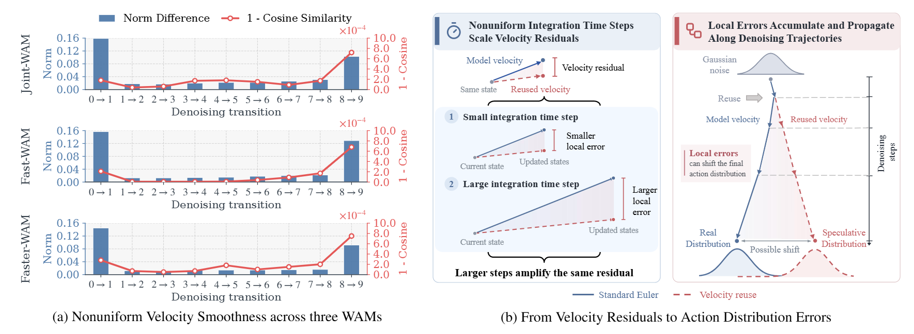
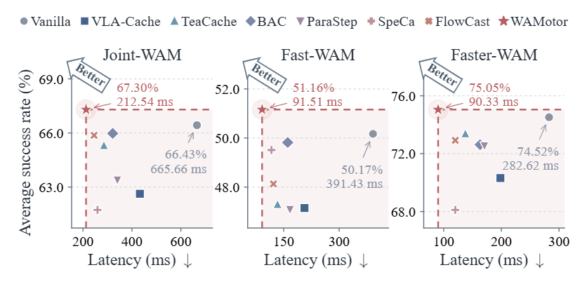

<div align="center">
<h2><nobr>WAMotor: Accelerating World Action Models via Speculative Inference</nobr><br><nobr> under Dual Nonuniform Denoising Dynamics</nobr></h2>

<b>Zexun Lin</b><sup>1,2</sup> &middot; <b>Yuan Feng</b><sup>1,2</sup> &middot; <b>Xike Xie</b><sup>1,2,*</sup><br>
University of Science and Technology of China (USTC)<sup>1</sup><br>Data Darkness Lab, MIRACLE Center, Suzhou Institute for Advanced Research, USTC<sup>2</sup>

<a href="./README.md"></a> <a href="./README_zh.md"></a> <a href="https://arxiv.org/pdf/2611.25413"></a>
    
</div>


**WAMotor** revisit the denoising dynamics of WAMs and identify a dual nonuniformity: velocity smoothness is nonuniform as adjacent velocity residuals differ sharply at early and final steps, so reuse there yields large residuals, which nonuniform integration time steps further translate into local state errors that accumulate into the final action distribution. Based on this, we propose WAMotor, it selects reliable anchor velocities by deferring speculation and employs time-step-aware verification that scales acceptance thresholds by integration time step size.

<div align="center">
  
</div>

WAMotor achieves 2.86 $\times$ -- 4.28 $\times$ end-to-end speedups across three WAMs in both in-distribution (ID) and out-of-distribution (OOD) settings, while maintaining comparable task success rates.

<div  align="center">
    
</div>


## Table of Contents

- [File Structure](#file-structure)
- [Environment Setup](#environment-setup)
- [Evaluation](#evaluation)
- [Acknowledgments](#acknowledgments)
- [Cite](#cite)

## File Structure

```text
WAMotor/
├── configs/
│   ├── data/                    # Observation processing configs
│   ├── model/                   # JointWAM, FastWAM, and FasterWAM
│   ├── task/                    # Model and benchmark settings
│   ├── inference.yaml           # Shared inference defaults
│   ├── sim_libero.yaml
│   ├── sim_libero_plus.yaml
│   └── sim_robotwin.yaml
├── environments/                # Benchmark environments and lockfiles
├── scripts/
│   ├── setup/
│   ├── eval_libero.sh
│   ├── eval_libero_plus.sh
│   └── eval_robotwin.sh
├── experiments/
│   ├── latency/                 # LIBERO-Like latency evaluation
│   ├── libero/                  # LIBERO and LIBERO-plus success rate evaluation
│   └── robotwin/                # RoboTwin success rate evaluation
├── src/wamotor/
│   ├── models/wan22/            # Model implementations
│   │   └── speculative/         # [Speculative Inference] Core implementation of WAMotor
│   └── processing/              # Observation and action processing
├── third_party/RoboTwin/
├── checkpoints/                 # Model weights, downloaded separately
└── evaluate_results/            # Generated evaluation results
```

## Environment Setup

Execute the commands from the repository root. Install [uv](https://docs.astral.sh/uv/) before creating the Python 3.10 environment with PyTorch 2.7.1 and CUDA 12.8 wheels:

```bash
bash scripts/setup/install_core.sh
source .venv/bin/activate
```

Checkpoint preparation: Create a checkpoint directory and download the checkpoints following the setup instructions for Joint-WAM, Fast-WAM, or Faster-WAM, depending on the model you use.

```bash
mkdir -p checkpoints
export DIFFSYNTH_MODEL_BASE_PATH="$(pwd)/checkpoints"
```

## Evaluation

LIBERO, LIBERO-Plus, and RoboTwin are managed in three separate uv environments to isolate their simulator dependencies. Run the corresponding setup command once before evaluation; each evaluation launcher automatically uses the matching environment.

### LIBERO

```bash
bash scripts/setup/install_libero.sh

CUDA_VISIBLE_DEVICES=0,1 \
TASK_NAME="<task_name>" \
CKPT_PATH="<checkpoint_path>" \
DATASET_STATS_PATH="<dataset_stats_path>" \
NUM_GPUS=2 \
MAX_TASKS_PER_GPU=1 \
bash scripts/eval_libero.sh --speculative
```

### LIBERO-Plus

```bash
bash scripts/setup/install_libero_plus.sh

CUDA_VISIBLE_DEVICES=0,1 \
TASK_NAME="<task_name>" \
CKPT_PATH="<checkpoint_path>" \
DATASET_STATS_PATH="<dataset_stats_path>" \
NUM_GPUS=2 \
MAX_TASKS_PER_GPU=1 \
bash scripts/eval_libero_plus.sh --speculative
```

### RoboTwin

```bash
bash scripts/setup/install_robotwin.sh

CUDA_VISIBLE_DEVICES=0,1 \
TASK_NAME="<task_name>" \
CKPT_PATH="<checkpoint_path>" \
DATASET_STATS_PATH="<dataset_stats_path>" \
NUM_GPUS=2 \
MAX_TASKS_PER_GPU=1 \
bash scripts/eval_robotwin.sh --speculative
```

### Latency

```bash
CUDA_VISIBLE_DEVICES=0 \
TASK_NAME="<task_name>" \
CKPT_PATH="<checkpoint_path>" \
DATASET_STATS_PATH="<dataset_stats_path>" \
bash experiments/latency/run_latency.sh --speculative
```

## Acknowledgments

Our codebase is built upon:

* Fast-WAM: https://github.com/yuantianyuan01/FastWAM
* Faster-WAM: https://github.com/hustvl/FasterWAM
* Wan2.2: https://github.com/Wan-Video/Wan2.2
* LIBERO: https://github.com/Lifelong-Robot-Learning/LIBERO
* LIBERO-Plus: https://github.com/sylvestf/LIBERO-plus
* RoboTwin: https://github.com/RoboTwin-Platform/RoboTwin

We thank these teams for contributing their impressive code and models to the community.

## Cite

If you find this repository helpful for your research, please consider citing our paper:

```bibtex
@article{lin2026wamotor,
  title   = {Faster-WAM: Efficient Inference-Time Future Conditioning for Robust World Action Models},
  author  = {Zexun, Lin and Yuan Feng and Xike Xie},
  journal = {arXiv preprint arXiv:2611.25413},
  year    = {2026}
}
```