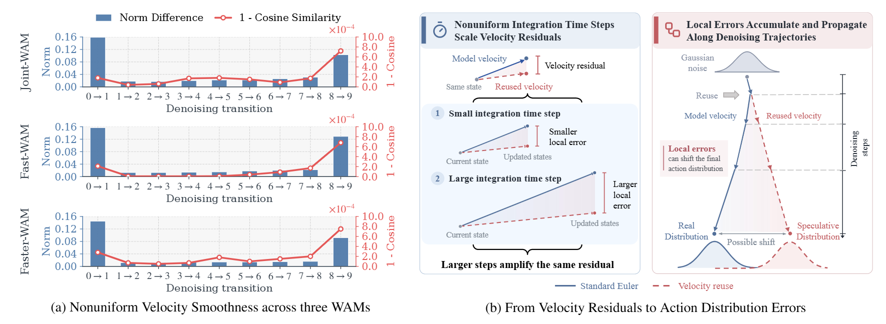
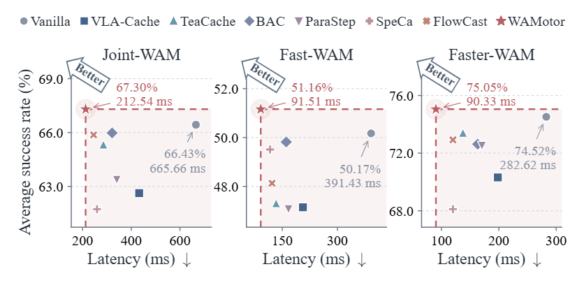

<div align="center">
<h2><nobr>WAMotor: Accelerating World Action Models via Speculative Inference</nobr><br><nobr> under Dual Nonuniform Denoising Dynamics</nobr></h2>

<b>Zexun Lin</b><sup>1,2</sup> &middot; <b>Yuan Feng</b><sup>1,2</sup> &middot; <b>Xike Xie</b><sup>1,2,*</sup><br>
University of Science and Technology of China (USTC)<sup>1</sup><br>Data Darkness Lab, MIRACLE Center, Suzhou Institute for Advanced Research, USTC<sup>2</sup>
    
<a href="./README.md"></a> <a href="./README_zh.md"></a> <a href="https://arxiv.org/pdf/2611.25413"></a>
    
</div>

**WAMotor** 重新审视了世界动作模型的去噪过程，并发现了两种非均匀性：速度平滑性并不均匀，因为相邻速度残差在早期和最终步骤会发生剧烈变化，因此在这些位置复用速度会产生较大的残差；此外，非均匀的积分时间步会进一步将这些残差转化为局部状态误差，并累积到最终的动作分布中。基于这一观察，我们提出了 WAMotor：它通过延迟推测来选择可靠的锚点速度，并采用时间步感知的验证机制，根据积分时间步长缩放接受阈值。

<div align="center">
  
</div>

在保持任务成功率基本相当的同时，WAMotor 在三种 WAM 上、分布内和分布外两种设置下，均实现了端到端 **2.86 倍至 4.28 倍** 的加速。

<div  align="center">
    
</div>

## 目录

- [文件结构](#文件结构)
- [环境配置](#环境配置)
- [评测](#评测)
- [致谢](#致谢)
- [引用](#引用)

## 文件结构

```text
WAMotor/
├── configs/
│   ├── data/                    # 观测处理配置
│   ├── model/                   # JointWAM、FastWAM 和 FasterWAM
│   ├── task/                    # 模型和基准测试设置
│   ├── inference.yaml           # 共享的推理默认配置
│   ├── sim_libero.yaml
│   ├── sim_libero_plus.yaml
│   └── sim_robotwin.yaml
├── environments/                # 基准测试环境及其 lockfile
├── scripts/
│   ├── setup/
│   ├── eval_libero.sh
│   ├── eval_libero_plus.sh
│   └── eval_robotwin.sh
├── experiments/
│   ├── latency/                 # LIBERO-Like 延迟评测
│   ├── libero/                  # LIBERO 和 LIBERO-Plus 成功率评测
│   └── robotwin/                # RoboTwin 成功率评测
├── src/wamotor/
│   ├── models/wan22/            # 模型实现
│   │   └── speculative/         # [推测式推理] WAMotor 核心实现
│   └── processing/              # 观测和动作处理
├── third_party/RoboTwin/
├── checkpoints/                 # 模型权重，需单独下载
└── evaluate_results/            # 生成的评测结果
```

## 环境配置

请在仓库根目录执行以下命令。在使用 PyTorch 2.7.1 和 CUDA 12.8 wheel 创建 Python 3.10 环境前，请先安装 [uv](https://docs.astral.sh/uv/)：

```bash
bash scripts/setup/install_core.sh
source .venv/bin/activate
```

检查点准备：创建检查点目录，并根据所使用的模型（Joint-WAM、Fast-WAM 或 Faster-WAM）按照相应的配置说明下载检查点。

```bash
mkdir -p checkpoints
export DIFFSYNTH_MODEL_BASE_PATH="$(pwd)/checkpoints"
```

## 评测

LIBERO、LIBERO-Plus 和 RoboTwin 分别使用三个独立的 uv 环境管理，以隔离各自的模拟器依赖。评测前请运行对应的环境配置命令一次；每个评测启动脚本都会自动使用匹配的环境。

### LIBERO

```bash
bash scripts/setup/install_libero.sh

CUDA_VISIBLE_DEVICES=0,1 \
TASK_NAME="<task_name>" \
CKPT_PATH="<checkpoint_path>" \
DATASET_STATS_PATH="<dataset_stats_path>" \
NUM_GPUS=2 \
MAX_TASKS_PER_GPU=1 \
bash scripts/eval_libero.sh --speculative
```

### LIBERO-Plus

```bash
bash scripts/setup/install_libero_plus.sh

CUDA_VISIBLE_DEVICES=0,1 \
TASK_NAME="<task_name>" \
CKPT_PATH="<checkpoint_path>" \
DATASET_STATS_PATH="<dataset_stats_path>" \
NUM_GPUS=2 \
MAX_TASKS_PER_GPU=1 \
bash scripts/eval_libero_plus.sh --speculative
```

### RoboTwin

```bash
bash scripts/setup/install_robotwin.sh

CUDA_VISIBLE_DEVICES=0,1 \
TASK_NAME="<task_name>" \
CKPT_PATH="<checkpoint_path>" \
DATASET_STATS_PATH="<dataset_stats_path>" \
NUM_GPUS=2 \
MAX_TASKS_PER_GPU=1 \
bash scripts/eval_robotwin.sh --speculative
```

### 延迟评测

```bash
CUDA_VISIBLE_DEVICES=0 \
TASK_NAME="<task_name>" \
CKPT_PATH="<checkpoint_path>" \
DATASET_STATS_PATH="<dataset_stats_path>" \
bash experiments/latency/run_latency.sh --speculative
```

## 致谢

我们的代码库基于以下项目构建：

* Fast-WAM: https://github.com/yuantianyuan01/FastWAM
* Faster-WAM: https://github.com/hustvl/FasterWAM
* Wan2.2: https://github.com/Wan-Video/Wan2.2
* LIBERO: https://github.com/Lifelong-Robot-Learning/LIBERO
* LIBERO-Plus: https://github.com/sylvestf/LIBERO-plus
* RoboTwin: https://github.com/RoboTwin-Platform/RoboTwin

感谢这些团队为社区贡献了出色的代码和模型。

## 引用

如果本仓库对你的研究有所帮助，欢迎引用我们的论文：

```bibtex
@article{lin2026wamotor,
  title   = {Faster-WAM: Efficient Inference-Time Future Conditioning for Robust World Action Models},
  author  = {Zexun, Lin and Yuan Feng and Xike Xie},
  journal = {arXiv preprint arXiv:2611.25413},
  year    = {2026}
}
```
